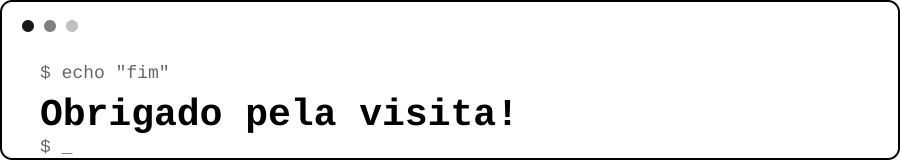

## 🧭 Sobre mim

- 🎓 Desenvolvedor backend com foco em **Java** e **Spring Boot**
- 📍 Santa Catarina — Brasil
- 📚 Iniciando graduação em Engenharia de Software em 2027
- 🔭 Estudando atualmente **Spring Security**, **JWT** e boas práticas para APIs REST
- 🚀 Buscando criar soluções escaláveis, seguras e bem estruturadas

## 🛠️ Stack e ferramentas

## 📌 Projetos Fixados

| Projeto | Descrição | Stack |
| --- | --- | --- |
| **[Marketplace-Delivery](https://github.com/JoaoVitorAlves-dev/Marketplace-Delivery)** | Marketplace de delivery multi-restaurante, com autenticação JWT e autorização por roles. | Java · Spring Boot · MySQL |
| **[E-commerce-funcional](https://github.com/JoaoVitorAlves-dev/E-commerce-funcional)** | E-commerce com catálogo de produtos, carrinho de compras e gestão de pedidos, com autenticação JWT e autorização por roles. | Java · Spring Boot · PostgreSQL |
| **[Sistema-de-Academia](https://github.com/JoaoVitorAlves-dev/Sistema-de-Academia)** | Sistema de gerenciamento de academia, com controle de alunos, planos e matrículas, com autenticação JWT e autorização por roles. | Java · Spring Boot · PostgreSQL |
| **[Clinica-Medica](https://github.com/JoaoVitorAlves-dev/Clinica-Medica)** | Sistema de gestão para clínica médica, com cadastro de pacientes e médicos e agendamento de consultas, com autenticação JWT e autorização por roles. | Java · Spring Boot · PostgreSQL |

## 📫 Contato

